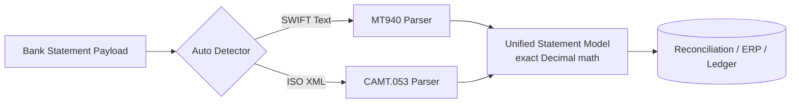

# mt940-camt-parser

[](https://github.com/yasinbalcik/mt940-camt-parser/actions/workflows/ci.yml)


Zero-dependency Python library for parsing enterprise bank statements in **SWIFT MT940** (flat text) and **ISO 20022 CAMT.053** (XML) formats into a unified, type-safe data model.

Engineered for payment automation, treasury systems, ERP bank integrations, and automated reconciliation engines.

## Key Capabilities

- **Zero Runtime Dependencies:** Implemented entirely using Python standard library (`decimal`, `dataclasses`, `xml.etree.ElementTree`, `re`).
- **Exact Decimal Arithmetic:** All monetary amounts are parsed directly into `decimal.Decimal` objects, eliminating floating-point rounding errors.
- **Unified Normalized Model:** Whether the bank statement comes as MT940 text or CAMT.053 XML, the output data structures (`Statement`, `TransactionEntry`, `Balance`) are identical.
- **Robust Line 86 Handling:** Handles multi-line continuation descriptions in SWIFT MT940 tag `:86:` across Turkish and international banking formats.
- **Auto-Detection:** Automatically inspects statement payload format and invokes the appropriate parser.

## Architecture



## Supported SWIFT MT940 Tags

| Tag | Name | Description |
| :--- | :--- | :--- |
| :20: | Transaction Reference | Statement transaction identifier |
| :25: | Account Identification | Account number or IBAN |
| :28C: | Statement / Sequence | Statement sequence number |
| :60F/M: | Opening Balance | Currency, value date, credit/debit indicator, amount |
| :61: | Statement Line | Value date, entry date, type, amount, reference |
| :86: | Information to Owner | Multi-line remittance information and description |
| :62F/M: | Closing Balance | Final booked balance for the period |

## Supported ISO 20022 CAMT.053 Elements

- `Stmt / Id` (Statement identification)
- `Stmt / Acct / Id / IBAN` (Account IBAN or internal identifier)
- `Stmt / Bal` with `OPBD` (Opening Booked) and `CLBD` (Closing Booked)
- `Stmt / Ntry` (Entry amount, credit/debit indicator, booking/value dates, remittance info `Ustrd`)

## Installation

```bash
pip install mt940-camt-parser
```

## Usage

### Auto-Detection

```python
from mt940_camt_parser import parse_statement, EntryType

with open("statement.sta", "r", encoding="utf-8") as f:
    statements = parse_statement(f.read())

for stmt in statements:
    print(f"Format: {stmt.source_format}")
    print(f"Account: {stmt.account_identification}")
    print(f"Opening: {stmt.opening_balance.amount} {stmt.currency}")
    print(f"Closing: {stmt.closing_balance.amount} {stmt.currency}")
    print(f"Total Credits: {stmt.total_credits} | Total Debits: {stmt.total_debits}")

    for entry in stmt.entries:
        sign = "+" if entry.entry_type == EntryType.CREDIT else "-"
        print(f"  [{entry.booking_date}] {sign}{entry.amount} | {entry.description}")
```

### Direct Parser Calls

```python
from mt940_camt_parser import parse_mt940, parse_camt053

# Parse SWIFT MT940 directly
mt940_stmts = parse_mt940(raw_text)

# Parse ISO 20022 CAMT.053 XML directly
camt_stmts = parse_camt053(xml_text)
```

### Command-Line Interface (CLI)

```bash
python -m mt940_camt_parser path/to/statement.sta
```

## Running Tests

```bash
python -m unittest discover tests
```

## License

MIT © Yasin BALÇIK
